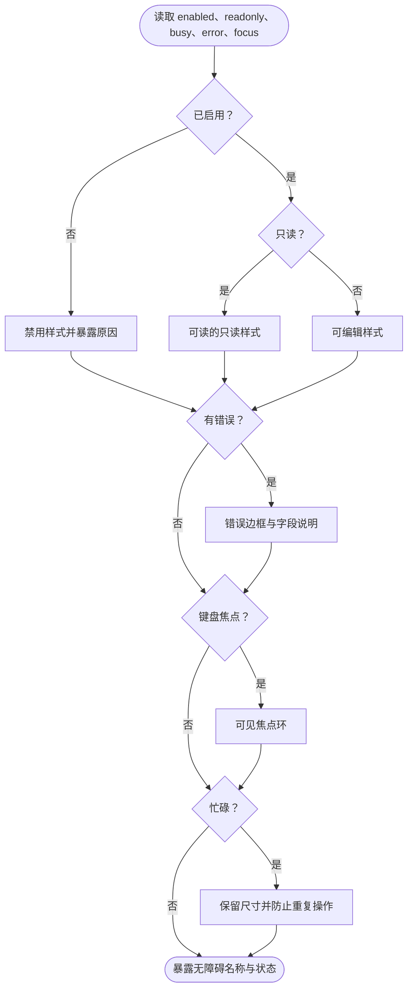

# MyDeployMate UI 设计规范

评审稿 v0.4 · 2026 年 10 月 23 日

> **文档状态**：待评审。v0.1 原稿见 `original/UI设计规范.pdf`。本稿把 v0.1 转成 Markdown，并按 2026-10-21 的决策改写：实现为 Tauri 2 + Vue 3，设计变量以 CSS 自定义属性落在 `src/styles/tokens.css`。凡是 v0.2 修改或新增的内容都标了 **【v0.2】**，v0.3（2026-10-22 选定页面布局方案 B）修改的标 **【v0.3】**，v0.4（2026-10-23 增加深色主题、重做空状态）修改的标 **【v0.4】**；原待确认的 Q-1、Q-4 已于 2026-10-21 确认。
>
> **定位**：本稿规定视觉语言、设计变量、布局、组件和视觉验收标准，与《软件需求规格说明书》《交互设计说明书》《架构设计文档》v0.2 配套，不替代业务规则或操作流程。原 Demo（`demo/server_manager_demo.py`）为布局方向参考，本文不是对其界面的测量或复刻声明。对比度数值为色值计算结果，不代表成品已通过可访问性测试。

## v0.4 修订摘要

2026-10-23 阶段 3 真机走查后的 UI 调整。

| 范围 | 修订内容 |
|---|---|
| UI-02 | 交付浅色、深色两套主题，默认跟随 Windows，可在配置中心“外观”切换 |
| 第 2 节 | 新增深色变量表与阴影、遮罩变量 |
| UI-05 | 补深色计算值 |
| UI-19 | 空状态可带图标、一句说明和首次使用引导 |
| 第 11 节 | 深色主题移出“暂不纳入” |
| UI-09 | 表格和带边框区块圆角由 4 px 改为 6 px；滚动条统一为细样式，滑块颜色随主题（`--scrollbar-thumb`） |
| UI-15 | 新增 tonal、info 两种浅色调按钮；上下文栏三个按钮各用一种底色 |
| UI-15 | 字段旁的“插入变量”按钮改为与输入框等高的青绿浅底按钮 |
| UI-02、第 2 节 | 侧栏（图标栏、项目树）改为浅灰底，工作区改为白底；新增 `--surface-sidebar` 变量 |

## v0.3 修订摘要

2026-10-22 从三套布局方案中选定方案 B（布局画布：<https://claude.ai/artifact/Cu3SxwQWTBjrE4VsFeRakw>）。

| 范围 | 修订内容 |
|---|---|
| UI-10 | 一级导航改为 56 px 图标栏；“项目与流程”下增加 248 px 项目/流程树 |
| UI-11 | 流程编辑页不再带底部日志面板；运行详情为独立页面 |
| UI-26 | 日志视图位于运行详情页 |
| UI-34 | 更新入口改在图标栏底部 |

## v0.2 修订摘要

| 范围 | 修订内容 |
|---|---|
| 全文 | 产品名改为 MyDeployMate；删除 Qt Widgets 映射，实现为 Vue 组件 + CSS 变量 |
| 第 2 节 | 变量名改为 CSS 自定义属性；确认采用 v0.1 规范值，`tokens.css` 已重写 |
| UI-02 | P0 只交付浅色主题 |
| UI-04 | 单位说明改为 WebView2 的 CSS px |
| UI-08 | 图标库定为 Lucide（`lucide-vue-next`） |
| UI-20、UI-21 | 新增执行顺序与“跳过该服务器”的呈现 |
| UI-23 | 远程命令新增“程序及参数”写法（Q-1 已确认） |
| UI-27 | 新增“记住此凭据”复选框与已保存凭据列表 |
| UI-33 | 新增：执行顺序控件 |
| UI-34 | 新增：应用更新提示 |
| V-14 | 原“正式/模拟切换”删除（不做模拟模式），改为更新与已保存凭据检查 |
| 第 10 节 | 组件状态决策图由 PlantUML 改为 Mermaid |

---

## 1 产品视觉原则

### UI-01 面向反复操作的工具

用户主要任务是选择项目与环境、编辑流程、检查目标和查看运行结果。视觉优先级依次为操作对象、当前状态、关键动作、明细。默认首屏为工作界面，不做宣传首页、巨型标题、装饰性背景图或统计大卡片。页面区块使用连续平面和分隔线，不将参数表、日志表、服务器表层层装进卡片。

### UI-02 视觉基调 【v0.4 更新】

左侧图标栏和项目树用浅灰底，右侧工作区用白底，深灰正文；青绿色只用于品牌与主要动作，蓝色用于焦点和进行状态，绿色/红色/琥珀色用于语义反馈，少量紫色专用于结果未知。避免整页单一色系、渐变背景和发光装饰；浅色主题下不使用大面积深色侧栏。

【v0.4】P0 交付浅色和深色两套主题。深色是单独取值的一套变量，不通过简单反色生成，语义分工与浅色相同。配置中心“外观”提供“跟随系统 / 浅色 / 深色”，默认跟随 Windows 的应用模式，切换立即生效，窗口标题栏同步。该选项只保存在本机，不写入配置文件，也不随导出。

### UI-03 状态不替代事实

生产环境标识不等于服务器危险或失败；SSH 最近测试成功不等于持续在线；上传进度 100% 不等于最终重命名提交成功；已取消不等于已回滚；结果未知不能用灰色成功图标表达。状态应与 SRS RUN-06 的运行/任务模型一致，不能为了颜色统一合并不同状态。

### UI-04 单位与缩放 【v0.2 更新】

本规范尺寸以 CSS px 表达，在 WebView2 中即逻辑像素（DIP），不能当作设备物理像素。尊重 Windows 显示缩放，不在系统缩放之外再按设备像素比放大，也不使用 CSS `zoom`。所有文字字距为 0，不按窗口宽度缩放字号；空间不足时先换行、折叠次要区域或启用滚动。

---

## 2 颜色与语义设计变量 【v0.2，Q-4 已确认】

2026-10-21 确认采用 v0.1 规范值（颜色、字号与尺寸），`src/styles/tokens.css` 已按下表重写；Demo 提取的旧值不再使用。组件只使用变量，不写原始色值。

| 变量 | 色值 | 使用规则 |
|---|---|---|
| `--surface-canvas` | #F5F6F7 | 应用画布、页面间留白；不作为大面积强调色 |
| `--surface-panel` | #FFFFFF | 表格、编辑区、弹窗；主要文字以此为底核验 |
| `--surface-hover` | #EEF1F3 | 行与次级图标按钮悬停；不得改变布局尺寸 |
| `--surface-selected` | #E7F2F3 | 当前选中行背景；同时增加边线或勾选标识 |
| `--surface-sidebar` / `-hover` | #F5F6F7 / #E9ECEF | 【v0.4】图标栏与项目树底色及其悬停；工作区为 `--surface-panel` 白底 |
| `--text-primary` | #202428 | 正文、字段值、命令及重要名称 |
| `--text-secondary` | #59636E | 次级上下文、时间和占位符；不能用极浅灰替代 |
| `--border-subtle` | #D9DEE3 | 页面分隔、表格行线；不得单独承担输入框可识别边界 |
| `--border-control` | #8A949E | 白底输入框、复选框、必要操作边界 |
| `--action-primary` | #006D77 | 主要提交按钮与选中导航标记 |
| `--action-hover` | #005C64 | 主要按钮悬停；文字仍白色 |
| `--action-pressed` | #004C53 | 按下状态；不缩小或移动按钮 |
| `--focus-ring` | #2563EB | 键盘焦点及进行状态；不与错误边框互相覆盖 |
| `--state-success` / `-bg` | #17663A / #EAF6EE | 成功文字与图标 |
| `--state-failure` / `-bg` | #B42318 / #FFF0EE | 失败及危险确认 |
| `--state-warning` / `-bg` | #8A5100 / #FFF4D6 | 等待、生产确认与风险 |
| `--state-running` / `-bg` | #175CD3 / #EFF6FF | 运行中及信息 |
| `--state-unknown` / `-bg` | #6B3FA0 / #F4EEFA | 结果未知/已中断的关键标记 |

【v0.4】深色主题（`:root[data-theme='dark']`）使用下表取值，未列出的变量（字体、尺寸、间距）两套共用。

| 变量 | 深色值 | 说明 |
|---|---|---|
| `--surface-canvas` | #15181B | 应用画布 |
| `--surface-panel` | #1D2125 | 表格、编辑区、弹窗；深色对比度以此为底核验 |
| `--surface-hover` | #262B30 | 悬停 |
| `--surface-selected` | #183538 | 选中行，带青绿色倾向 |
| `--surface-sidebar` / `-hover` | #15181B / #22272C | 图标栏与项目树 |
| `--text-primary` | #E6E9EC | 正文 |
| `--text-secondary` | #A3ADB7 | 次级信息 |
| `--text-on-action` | #0B1D20 | 主要按钮文字；深色下主按钮为浅青底深色字 |
| `--border-subtle` | #30363C | 分隔线 |
| `--border-control` | #6F7A85 | 输入框与控件边界 |
| `--action-primary` / `-hover` / `-pressed` | #4FB8C2 / #6AC6CF / #86D2DA | 主要动作；悬停和按下逐级变亮 |
| `--focus-ring` | #6EA8FE | 键盘焦点 |
| `--state-success` / `-bg` | #5CC98A / #13291C | 成功 |
| `--state-failure` / `-bg` | #FF8A7A / #3A1A17 | 失败及危险确认 |
| `--state-warning` / `-bg` | #F0B44C / #33260F | 警告 |
| `--state-running` / `-bg` | #6EA8FE / #142338 | 运行中及信息 |
| `--state-unknown` / `-bg` | #C4A2F0 / #2A1F3A | 结果未知 |

阴影与遮罩也是变量（`--shadow-popover`、`--shadow-toast`、`--shadow-dialog`、`--backdrop`），深色下加深，组件不写原始色值。

### UI-05 对比度目标

普通文字按至少 4.5:1、重要非文本控件和状态边界按至少 3:1 作为本项目设计目标，参考 W3C 的文字对比度与非文本对比度说明，而非宣称整个桌面软件已经获得 WCAG 认证。装饰分隔线与必要控件边界应区分。

白底计算值（2026-10-21 复核）：正文 15.62:1，次级文字 6.11:1，主要动作色 6.08:1，焦点蓝 5.17:1，失败红 6.57:1，成功绿 7.00:1，警告棕 6.45:1，运行蓝 5.99:1，未知紫 7.38:1，控件边框 3.08:1。白色主按钮文字与主要动作底色同为 6.08:1。（对照：Demo 原值的焦点色仅 2.29:1、输入框边框 1.33:1，不达标，因此不再使用。）不同状态浅底上的实际组合须另测，不能照搬白底结果；边框 3.08:1 仅用于白底内部表面，在灰画布上重新核验或加深，不把临界值当作任意背景通用色。

【v0.4】深色计算值（以 `--surface-panel` #1D2125 为底，2026-10-23）：正文 13.29:1，次级文字 7.11:1，主要动作色 6.92:1，焦点蓝 6.71:1，失败红 7.07:1，成功绿 7.85:1，控件边框 3.70:1；主按钮深色文字与动作底色 7.41:1；各状态色在对应状态底上 6.55:1 至 7.96:1。

### UI-06 禁用与只读

禁用状态用中性灰填充与文字、去除悬停动作，但保留可读原因；不可将整行透明度降到难以阅读。只读字段仍采用正文颜色，允许选择复制，不伪装成禁用。危险操作禁用后不能只靠悬浮提示解释，页面须有可通过键盘获取的原因文本或详情入口。

---

## 3 字体、图标与基础尺寸

| 角色 | 字号/行高/字重 | 场景 |
|---|---|---|
| 窗口/页面标题 | 20/28，600 | 项目名或页面名；不使用营销式超大标题 |
| 区域标题 | 16/24，600 | 参数区、运行摘要、弹窗小节 |
| 正文/表单/导航 | 14/22，400 | 字段、值、操作及列表主要内容 |
| 表头/按钮 | 14/20，500–600 | 表头、主要提交、页签 |
| 次级信息 | 12/18，400 | 时间、来源、辅助状态；不用于命令正文 |
| 代码/日志 | 13/20，400 | 命令、路径、变量、退出码；允许用户调整到 16 px |
| 弹窗标题 | 18/26，600 | 发布确认、服务器编辑、凭据输入 |

【v0.2】采用上表（Q-4 已确认），不沿用 Demo 的 13 px 正文。

### UI-07 字体与数字

中文使用系统清晰无衬线字体：`"Microsoft YaHei UI", "Segoe UI", system-ui, sans-serif`。代码优先 `"Cascadia Mono", Consolas, monospace`；中文回退不强求每个字都占单个英文列宽。版本号、耗时、进度使用等宽数字（`font-variant-numeric: tabular-nums`）以避免跳动。路径和命令保持可选中复制，不通过图片显示。

### UI-08 图标规范 【v0.2 更新】

使用 Lucide（`lucide-vue-next`，与 Demo 一致），不混用不同线宽和填充风格。常用图标 16 或 18 px，重要状态 20 px，线宽 1.75–2 px；图标按钮可点区域 32×32 px，主要工具栏可用 36×36 px。保存、复制、删除、上下移、文件浏览、眼睛、跟随日志、导出等优先图标，提供名称和悬浮提示；执行、取消运行、备份并替换等明确命令使用文字或图标加文字。

### UI-09 间距与形状 【v0.4 更新】

间距标尺为 4、8、12、16、24、32 px；控件内图标与文字间距 6–8 px，表单行间距 16 px，小节间距 24 px，页面内边距 20–24 px。输入框和按钮圆角 4 px；弹窗最多 8 px；【v0.4】表格、带边框的区块、代码与日志表面 6 px，表格外框必须真正呈现圆角。滚动条使用系统细样式（`scrollbar-width: thin`），轨道透明，滑块用 `--scrollbar-thumb`（浅色 #B8C0C8，深色 #4A525A）。页面区块不用阴影卡片；只有悬浮菜单、弹窗、临时提示允许克制阴影；不能靠阴影替代必要边界。

---

## 4 窗口和页面布局

### UI-10 框架尺寸 【v0.3 更新】

基准内容视口 1440×900，最低目标内容视口 1280×720，均为逻辑像素；Tauri 窗口 `minWidth/minHeight` 按此设置，系统标题栏不计入内容视口。一级导航为 56 px 图标栏（图标 20 px，命中区 40×40 px，每项有悬浮提示和无障碍名称，当前项用浅青底加 3 px 左边线）；“项目与流程”页在图标栏右侧显示 248 px 项目/流程树，可收起；上下文栏高 56 px；项目页签区高 40 px；主要工具栏高 44 px。设计验收同时记录物理分辨率、系统缩放和实际逻辑视口，不能把 1280×720 物理屏幕在 125% 下仍当作同等逻辑空间。

### UI-11 流程编辑布局 【v0.3 更新】

左侧步骤列表最小 320 px，右侧参数最小 420 px，中间分隔间距 12–16 px；可拖动比例，默认约 44:56。流程编辑页不带日志面板，参数区占满剩余高度；有活跃运行时上下文栏显示运行状态标签，点击进入独立的运行详情页（P07）。1280 px 宽时扣除图标栏与项目树后仍能容纳列表与参数的最小宽度。低于同时容纳列表与参数的宽度时，参数切换为右侧抽屉，步骤列表保持可用；抽屉关闭不丢失草稿。拖动分隔条命中区至少 8 px，不能被选中文字替代。

### UI-12 工具栏与长内容

顶部始终显示项目、环境和流程，过长项目名可省略但可悬浮查看；环境不可省略到无法区分 production/staging。主要动作保留保存、预览和执行，次要操作进入更多菜单，不产生两行杂乱按钮。服务器指纹在信任弹窗、执行命令在确认详情、危险操作对象名称在确认正文不得只显示省略号；采用换行或可滚动完整文本。

### UI-13 表格布局

服务器与历史用表格，不用一台服务器一张大卡片。普通表格行高 40 px，紧凑行可为 36 px；表头 36 px。有两行内容时行高自动增至至少 56 px，不压缩行距。复选列 40 px、操作列按实际图标数固定；名称/地址/时间等列设最小宽度，溢出允许表格自身横向滚动，不让整个窗口横向滚动。标题区和操作列不因测试文字变化而改变宽度。

### UI-14 弹窗尺寸与层级

普通配置弹窗宽 640 px，服务器详细编辑可 720 px，发布预览 960 px，密码弹窗 480 px；所有宽度不得超过视口减 48 px，高度不得超过视口减 64 px。弹窗头部和底部动作区固定，正文独立滚动。焦点环与输入错误保留在滚动区域内。仅允许一个主弹窗加一个必要的确认层；不在服务器编辑内连续嵌套文件预览、测试结果和删除确认。系统原生文件选择器（Tauri dialog 插件）可独立出现。

---

## 5 基础组件状态

### UI-15 按钮 【v0.4 更新】

标准按钮高 36 px，紧凑 32 px，左右内边距 12 px，含图标时间隔 8 px。主按钮青绿白字，次按钮白底深字，危险最终确认红底白字，工具按钮透明底。单个操作区域通常只突出一个主提交；取消为次级。【v0.4】主按钮旁的并列动作可用浅色调按钮区分：青绿浅底青绿字（tonal，如“保存”，5.33:1）和蓝色浅底蓝字（info，如“预览”，5.50:1）；项目上下文栏为“保存 tonal · 预览 info · 执行 主按钮”。不可用时三种按钮都回到 UI-06 的中性灰，原因文本照常提供。字段旁的“插入变量”按钮（{}）用 tonal 样式，与输入框等高，悬停和展开时加深。忙碌时保留原宽度，用图标和状态文字替换内容，不向邻居挤占空间；防重复提交由业务层（Rust 侧幂等键）保障，不能只靠按钮变灰。

### UI-16 输入组件

单行输入高 36 px，标签在上，标签与输入间距 6 px；占位符不可代替标签或作为已填值。多行命令输入初始至少 6 行，最小 144 px，可拉伸；禁用浏览按钮不妨碍编辑允许的手填路径。端口和超时用数字步进控件；选择集合用下拉，启用用开关，目标多选用复选框。字段错误为红色边框加下方明确文字，不将值自动清空。

### UI-17 焦点、悬停与只读态

控件状态至少覆盖默认、悬停、按下、键盘焦点、禁用、只读、错误、忙碌。焦点使用 2 px 焦点色线和 2 px 间隔（`:focus-visible`），在弹窗边缘不被裁剪；错误时仍保留焦点，不能只显示红边。悬停仅改变底色或边线，不放大、跳动或改变行高。只读文本可复制，密码仍遵守遮蔽策略。

### UI-18 菜单、页签与分段控件

页签展示页面，不承担提交；选中使用字重和底线，不能只改浅色。完整流程/仅本地命令、【v0.2】步骤优先/服务器优先使用分段控件；每段宽度预留最长标签，不随选择移动。环境选择器显示保护标识，保护状态和环境名分开。菜单项高至少 32 px，危险操作与普通项分组，不仅依靠图标区分；禁用项显示具体原因。

### UI-19 校验与提示

离开字段可展示校验问题，提交时显示全部已发现问题并定位首个；输入途中不要每个字符都弹窗。校验结果来自 Rust（`validate_config`），前端只负责定位与呈现。普通保存成功可用 3 秒提示，关键失败、权限拒绝、身份变化、未知结果须留在页面直到处理。【v0.4】空状态居中呈现：线条图标、对象事实（如“尚无服务器”）、至多一句说明和下一项明确命令。没有任何项目时，项目页另列三步引导（添加服务器、新建项目、编辑流程），已完成的步骤打勾。筛选无结果使用紧凑样式并给出清除入口。不使用宣传或功能介绍长文、插画和示例数据。

---

## 6 业务组件

### UI-20 步骤行与参数面板 【v0.2 更新】

步骤行固定预留 32 px 序号、20 px 类型图标、弹性名称、启用开关及工具区；名称允许两行，不覆盖操作。选中行使用浅青底和 3 px 左边线。编辑选中态与运行当前态分开：运行当前任务用蓝色状态标记，不能自动把用户正在编辑的选中步骤反复跳走。禁用步骤显示“已禁用”，不使用失败红色。失败策略不是“继承流程”时，在行内以文字标签显示（失败继续、跳过该服务器），失败继续与跳过该服务器使用警告色。

### UI-21 目标与环境摘要 【v0.2 更新】

发布页顶部稳定显示环境、保护标识、执行顺序、目标总数；目标表包含服务器名、地址、账号、实际提权策略。生产/保护环境以琥珀标识和文字显示，不整页染红。已选但被筛选隐藏的目标必须保留计数和查看入口；临时目标子集与保存绑定分开显示，不能让用户误以为取消勾选已永久修改项目。

### UI-22 变量与命令预览

变量表显示名称、默认值、环境覆盖、生效值和来源。未设置覆盖用明确“继承”标记，空字符串显示为空值状态，不能视觉混同。代码区使用等宽字体与行号，可复制；模板表达式用轻量语法色，未定义变量用下划线与错误文字，不仅变红。预览的原模板与解析结果采用页签或上下分区；敏感值呈固定掩码，不泄露实际长度。【v0.2】敏感变量的来源列显示“凭据管理器”或“环境变量 NAME”；导入后缺失值时显示“需填写”状态标签（警告色加文字），点击进入填写。服务器之间的差异逐台展示（SRS VAR-03）。

### UI-23 命令形式 【v0.2，Q-1 已确认】

远程命令步骤内用分段控件选择“脚本 / 程序及参数”，仍属于同一个 SSH 步骤。脚本显示多行编辑器；程序模式显示可执行路径和逐行参数列表（每行一个参数，可增删、上下移）。切换时不自动拆解或覆盖原内容：两种写法的草稿各自保留，保存时只保存当前所选写法，并在切换前提示另一种写法的内容不会保存。脚本模式选择 sudo 时，提权字段下方显示提示“以 Shell 形式提权，需要服务器授权 Shell”。

### UI-24 运行和任务状态

状态图标（Lucide）与文案映射：

| 状态 | 图标 | 颜色 |
|---|---|---|
| 排队 | clock | 灰 |
| 运行中 | loader（旋转） | 蓝 |
| 等待确认 | pause-circle | 琥珀 |
| 等待凭据 | key-round | 琥珀 |
| 成功 | check-circle | 绿 |
| 失败 | x-circle | 红 |
| 已取消 | octagon-x | 中性灰 |
| 已跳过 | skip-forward | 灰 |
| 结果未知 / 已中断 | circle-help | 紫 |

运行“已中断”与任务“结果未知”各自保留名称。不能把出现 stderr 自动映射为运行失败，须以任务状态为准。

### UI-25 进度与稳定尺寸

任务进度显示完成数/总数，例如 3/7；完成包括终态，但总成功数另列，不能把跳过算成成功。上传进度显示已传字节/已知总字节及文件数；枚举目录前总量未知使用不定进度，不虚构百分比。字节达到总量但尚未提交时显示“正在提交”。没有可测量总量的命令仅显示耗时与运行图标，不假装有精确进度。

### UI-26 日志视图 【v0.3 更新】

日志位于运行详情页（P07）右侧，占满任务详情下方的剩余高度。默认白或极浅灰底，正文深灰，stderr 带来源标识及克制强调；不使用大面积深蓝终端装饰。时间列建议 160 px、来源 72 px、正文弹性；窄窗口可将元信息合并为行首，但保留筛选上下文。字号默认 13 px、行高 20 px，横向滚动和手动换行可切换。暂停跟随时显示新增行数与回到底部图标，不自动抢焦点。错误筛选只改变视图，不能删改数据。【v0.2】日志使用虚拟列表（`@tanstack/vue-virtual`），正文一律按纯文本渲染，禁止 `v-html`。

### UI-27 密码与主机身份 【v0.2 更新】

密码框采用遮蔽输入，显示/隐藏图标固定位置；弹窗展示用途、服务器、登录用户，sudo 还显示提权目标。SSH 密码、私钥口令和 sudo 三种标题不可通用成“请输入密码”。输入框下方提供“记住此凭据（保存到 Windows 凭据管理器）”复选框，默认不勾选；使用已保存凭据失败时，弹窗说明“已保存的凭据验证失败，请重新输入”。配置中心的已保存凭据列表只显示用途、服务器和用户，提供逐条清除和全部清除。主机指纹使用等宽完整文本，可换行复制；旧、新指纹分区对齐，差异不能仅靠颜色。确认信任的按钮不得默认为 Enter 自动触发。

### UI-28 导入、危险操作与历史

导入差异使用新增/修改/删除三组，分别有计数与文字，不用颜色差异作为唯一信息。全量替换最终按钮写明“备份并替换配置”。保护环境的执行确认需要键入环境名，输入框旁显示需键入的名称。历史详情采用只读视觉，标题加历史时间，不让用户误认成当前配置。再次执行进入当前配置预览，变更项用字段级对比；已删除流程的按钮明确不可用并说明原因。

### UI-33 执行顺序控件 【v0.2 新增】

流程设置中用分段控件选择“步骤优先 / 服务器优先”，下方一行文字说明当前顺序，例如“先在所有服务器上完成一步，再进行下一步”。发布预览的任务列表按实际顺序编号；服务器优先时按段分组，段标题显示段内服务器顺序。切换顺序后若存在“跳过该服务器”而顺序为步骤优先，相关步骤行显示错误并在预检中阻止开始。

### UI-34 应用更新提示 【v0.2 新增，v0.3 更新】

有新版本时在图标栏底部显示带标记的更新图标，悬浮提示与无障碍名称为“有新版本 x.y.z”，点击打开更新弹窗，不弹模态窗打断工作；检查失败只在配置中心显示最近一次检查结果，不重复弹窗。安装确认弹窗显示当前与新版本、更新说明和“将先备份配置”；有活跃运行时安装按钮禁用并显示原因。

---

## 7 一致的视觉状态矩阵

| 元素 | 正常/交互态 | 异常/不可用态 | 稳定性要求 |
|---|---|---|---|
| 输入框 | 白底、必要边框；焦点蓝环 | 红边加具体错误；只读仍可复制 | 错误区预留或自然扩展，不遮挡下一项 |
| 主按钮 | 青绿白字，按下更深 | 忙碌禁重复；不可用有原因 | 文字变化不改宽高 |
| 表格行 | 悬停浅灰，选中背景加标记 | 失败有状态列，不整行低透明度 | 操作区和时间列不抖动 |
| 步骤行 | 编辑选中与运行当前分别标识 | 禁用、跳过和失败各自独立 | 增删后焦点按 IXD 规则移动 |
| 密码框 | 遮蔽，可主动显示；可选记住 | 验证失败清空并聚焦 | 不因错误露出输入内容 |
| 进度条 | 有总量才显示确定比例 | 未知总量显示不定状态 | 100% 后仍可处于提交阶段 |
| 日志 | 当前筛选与跟随可辨 | 截断/丢失正文有常驻标记 | 追加不影响正在阅读的旧行 |

---

## 8 动效、可访问性与适配

### UI-29 动效

悬停/焦点转换 100–150 ms，抽屉与弹窗 120–180 ms；禁止大幅缩放和回弹。尊重系统减少动态效果设置（`prefers-reduced-motion`）。旋转图标仅用于确实进行中的操作，等待用户输入使用静态图标；长等待不使用循环假进度。状态变化可轻量强调一次，不持续闪烁或反复弹通知。

### UI-30 键盘和辅助技术

全部主要动作可通过键盘到达，复选和开关用 Space，菜单支持方向键，普通编辑按系统约定。Enter 不自动确认生产执行、主机信任或危险替换；密码输入可按 IXD 规则提交。图标有无障碍名称（`aria-label`），错误与对应字段关联（`aria-describedby`），状态变化通过 `aria-live` 适度宣布，连续日志不逐行朗读。颜色辨识困难、关闭动效及 Windows 高对比度模式（`forced-colors`）下仍能区分状态。

### UI-31 尺寸测试矩阵

至少测试逻辑视口 1440×900、1280×720 和 1920×1080；再覆盖 Windows 100%、125%、150%、200% 缩放及窗口跨屏。设备可用逻辑空间不足最低尺寸时进入紧凑布局，保留关键动作并允许局部滚动，不把整窗截到屏幕之外。字体放大导致按钮容不下时允许行高增加或改布局，不缩到不可读。所有测试记录实际截图尺寸，不只写“支持高 DPI”。

---

## 9 视觉验收与交付物

| 编号 | 测试输入 | 合格条件 |
|---|---|---|
| V-01 | 三个目标视口 | 顶部环境与关键动作可见，参数、日志、页签无相互遮挡 |
| V-02 | 64 字符名称和长 IPv6 | 名称不压住图标；执行对象可查看完整，端口列独立 |
| V-03 | 500 字符路径/命令 | 可滚动或换行，复制原文无截断，确认详情保留完整内容 |
| V-04 | 全部表单状态 | 每个输入的错误、只读、禁用、焦点有明确区别 |
| V-05 | 全任务/运行状态 | 颜色、文字、图标三者语义一致，未知不伪装成功 |
| V-06 | 两台变三台目标 | 预览由 7 项变 10 项，列表与底部按钮不重叠 |
| V-07 | 三次凭据错误 | 输入不泄露，次数反馈不挤压提交按钮或遮挡对象信息 |
| V-08 | 10000 行日志 | 滚动、筛选、返回最新可用；状态区不随日志推走 |
| V-09 | 仅键盘操作 | 能创建服务器、绑定、预览、取消；焦点可见且关闭弹窗后归位 |
| V-10 | 白底与各状态浅底 | 实测实际前景/背景组合达到本稿目标，不引用错误背景的计算值 |
| V-11 | 125%–200% 缩放 | 文字和图标清晰，局部滚动可达所有字段和危险确认内容 |
| V-12 | 减少动态效果 | 核心反馈仍存在，等待与运行可区分，没有必需动画依赖 |
| V-13 | 导入引用错误 | 错误常驻并可定位；不得只显示短暂失败提示 |
| V-14 | 【v0.2】服务器优先与跳过该服务器 | 预览按段分组，跳过的任务显示原因，与失败区分 |
| V-15 | 【v0.2】记住凭据与更新 | 已保存凭据列表不显示内容；更新入口不打断工作，活跃运行时不可安装 |

### UI-32 实现交付要求 【v0.2 更新】

交付统一设计变量文件 `src/styles/tokens.css`、开发模式下的组件状态展示页（覆盖本稿第 7 节状态矩阵，不是营销页面）、核心页面截图、视觉回归用例及对应版本号。所有业务页面复用同一组件与状态映射，不在各页面手写近似色值。最终验收基于真实实现与截图，本文本身不能证明 UI 已通过测试。

---

## 10 组件外观决策 【v0.2 改为 Mermaid】

说明字段装饰的组合顺序，而非互斥业务状态；例如错误与键盘焦点可同时存在。

---

## 11 追踪与待确认项

- UI-01–14 对应 IXD-01–05 与 SRS NFR-01–02，规定视觉结构与可读性。
- UI-15–19 对应 IXD-03–04、IXD-16–19，统一基础交互状态。
- UI-20–28、UI-33 对应 IXD-08–37、SRS RUN/SEC/OBS/CFG 各需求组。
- UI-34 对应 IXD-39、SRS NFR-04。
- 暂不纳入：品牌 Logo 重设计、移动端执行和无障碍认证。【v0.4】深色主题已纳入，见 UI-02。

待确认项：无（Q-1 命令形式、Q-4 视觉取值已于 2026-10-21 确认）。
