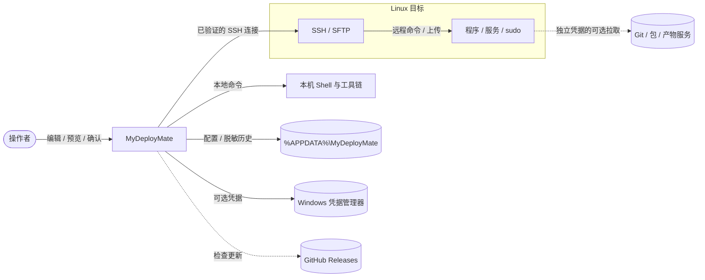
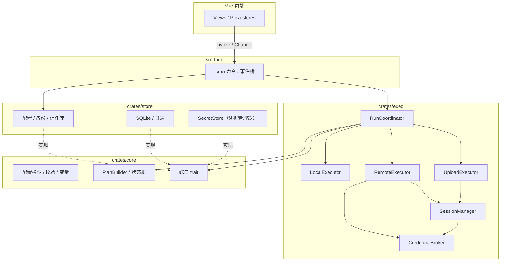
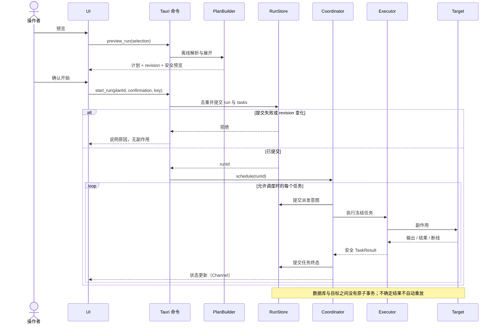
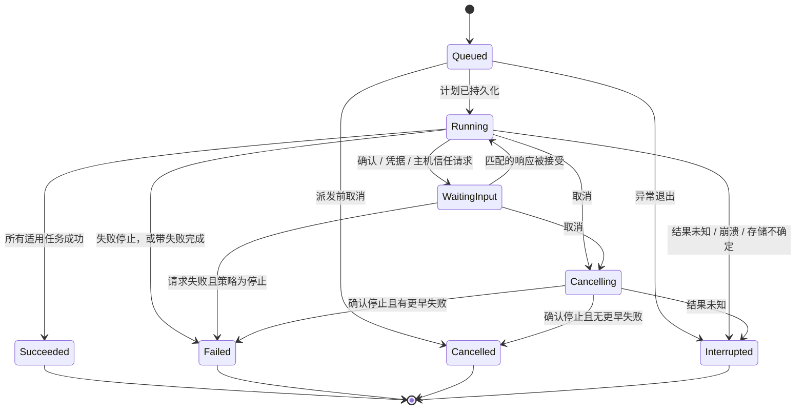
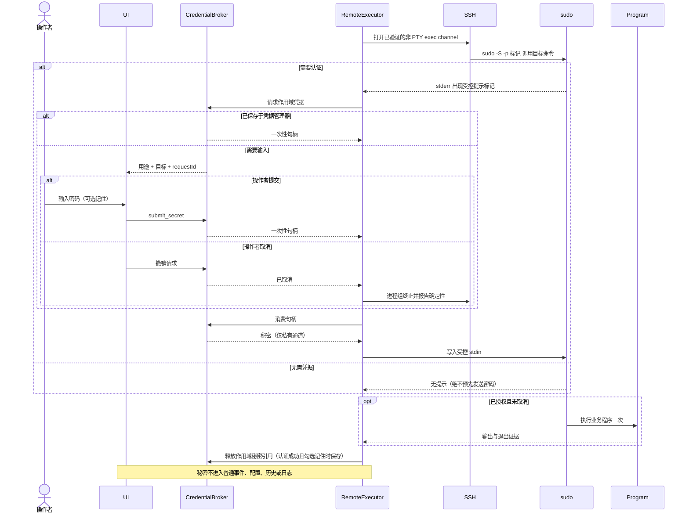

# MyDeployMate 架构设计文档

评审稿 v0.2 · 2026 年 10 月 21 日

> **文档状态**：待评审。v0.1 原稿见 `original/架构设计文档.pdf`。本稿把 v0.1 转成 Markdown，并按 2026-10-21 已确认的决策（《可行性分析与实施计划》第 6 节）和阶段 0 验证结论（同文第 8 节）改写。凡是 v0.2 修改或新增的内容都标了 **【v0.2】**；原待确认的 Q-1 至 Q-3 已于 2026-10-21 确认，处理结果见第 16 节。
>
> **依据**：《软件需求规格说明书》v0.2、《交互设计说明书》v0.2、《UI 设计规范》v0.2。本文给出模块边界、数据契约、执行模型、安全边界与测试策略，不代表代码已经实现。
>
> **核心决定**：服务器、语言、Git、Docker 和部署方式都通过配置与模板表达；基础执行器只有本地命令、SSH 命令、SFTP 上传，人工确认由调度器处理。采用模块化单体桌面应用，P0 不引入常驻远端代理、微服务、消息中间件或插件市场。

## v0.2 修订摘要

| 范围 | 修订内容 |
|---|---|
| 全文 | 产品名改为 MyDeployMate；技术栈由 Python + PySide6 + Paramiko 改为 Tauri 2 + Rust + Vue 3 + TS，russh / russh-sftp |
| ARC-03、ADR-02 | 写明已选技术与阶段 0 实测版本 |
| 第 2 节 | 逻辑模块映射到 Cargo workspace（`core`、`store`、`exec`、`src-tauri`）和 Vue 前端 |
| ARC-05–08 | 线程模型改为 tokio 任务 + WebView；工作区固定为 `%APPDATA%\MyDeployMate`，单实例 |
| ARC-09 | 新增执行顺序、失败策略“跳过该服务器”、输出编码、旧算法开关、`.ppk` 私钥 |
| ARC-12、ARC-15 | 计划生成和调度支持服务器优先与“跳过该服务器” |
| ARC-17、ARC-18 | Shell 定为 PowerShell、cmd、WSL；输出编码规则；Job Object |
| ARC-21 | ssh-rsa 默认剔除、按服务器开启；Pageant 与 OpenSSH Agent |
| ARC-22、ARC-23 | 远程命令以 `setsid` 包装并回传进程组，取消时按进程组终止并核验（阶段 0 已验证） |
| ARC-25、ARC-26 | sudo 探测结论；凭据可选保存到 Windows 凭据管理器 |
| ARC-29 | `posix-rename@openssh.com` 通过 russh-sftp 的扩展请求发送（已验证） |
| ARC-31 | 删除模拟模式目录；写明数据目录结构 |
| ARC-35 | 用例接口改为 Tauri 命令 + Channel 事件 |
| 第 12 节 | ADR 更新，新增 ADR-09（russh）、ADR-10（凭据保存）、ADR-11（更新） |
| 第 13 节 | 验证矩阵补充服务器优先、跳过该服务器、凭据管理器、更新 |
| 第 14 节 | 图表由 PlantUML 改为 Mermaid，GitHub 可直接渲染 |
| 第 15 节 | v0.1 的 CHG-01–05 逐项给出处理结果或待确认问题 |

---

## 1 目标、约束与系统边界

### ARC-01 架构驱动因素

优先满足 SCOPE-01–04、DATA-02–04、RUN-01–07、SEC-01–04。新增服务器或更换构建命令无需修改代码；多服务器的执行顺序可预测；预览与实际运行一致；密码不进入配置和日志；UI 不因网络阻塞；异常退出不误报成功。首版范围为 Windows 客户端、Linux SSH 目标、单操作者、单活跃运行（SRS SCOPE-03）。

### ARC-02 系统外部依赖

本机 Shell（PowerShell 5.1/7、cmd、WSL 发行版）与工具链由用户安装；目标主机提供 SSH、SFTP、所需命令及服务账号权限。远端 Git 拉取时，服务器到仓库的连接和凭据独立于客户端到服务器的 SSH 连接。产品不代替 sudoers 管理、不自动安装编译器、不保证跨平台命令兼容、不保证远程发布事务性。环境保护是误操作防护，不构成抵御本机管理员或恶意配置作者的安全边界。

**【v0.2】** 新增外部依赖：WebView2（Windows 11 预装）；Windows 凭据管理器（可选保存凭据时）；GitHub Releases（检查更新时，可关闭）。

### ARC-03 技术基线 【v0.2 改写】

| 层 | 选型 | 说明 |
|---|---|---|
| 桌面外壳 | Tauri 2 | WebView2 渲染；Rust 后端 |
| 前端 | Vue 3 + TypeScript + Vite + Pinia + Vue Router | 组合式 API；不做业务校验，只展示 Rust 返回的校验结果 |
| 异步运行时 | tokio | Tauri 2 自带 |
| SSH / SFTP | russh 0.64 + russh-sftp 3.0 | 阶段 0 实测 11/11 通过；exec 层封装成接口，必要时可换 ssh2 |
| 私钥解析 | ssh-key（`ppk` feature） | OpenSSH 格式与 PuTTY `.ppk` v2/v3 |
| 本地进程 | tokio::process + process-wrap（Job Object） | 进程树终止 |
| 输出解码 | encoding_rs | UTF-8 优先，回退 GBK |
| 配置 | serde_json，`workspace.json` 原子写 | 与导入导出同构 |
| 运行记录 | rusqlite（SQLite，WAL） | 运行、任务、决定、迁移版本 |
| 凭据保存 | keyring（Windows 凭据管理器） | 可选 |
| 秘密内存 | secrecy + zeroize | 尽力清理 |
| 前后端类型 | ts-rs 或 tauri-specta | 从 Rust 类型生成 TS 类型 |
| 图标 | lucide-vue-next | |

具体版本由 `Cargo.lock` 与 `package-lock.json` 固定。russh 关闭默认 feature，使用 `ring` 加密后端（`features = ["flate2", "ring", "rsa"]`）：默认的 aws-lc-rs 在 Windows 上编译需要 NASM，阶段 0 本机构建已确认失败；ring 只需 MSVC。

---

## 2 逻辑分层与模块职责

【v0.2】v0.1 的逻辑模块保留，映射到具体位置：

| 模块 | 位置 | 拥有的职责 | 明确不做的事 |
|---|---|---|---|
| Presentation | `src/`（Vue） | 页面、草稿、控件状态、焦点；把用户操作转换为 Tauri 命令 | 不直接访问文件、进程或网络；不重复实现业务校验 |
| ApplicationService | `src-tauri/src/commands/` | 保存配置、校验、预览、开始/取消、确认、历史查询、导入替换；装配各模块 | 不按 Rust/Python/Git 等业务工具分支 |
| Domain | `crates/core` | 类型化配置、变量规则、校验、执行计划（PlanBuilder）、运行状态机、失败与汇总策略、端口 trait | 不做 IO；不依赖 Tauri、tokio、russh、SQLite 或具体路径 |
| RunCoordinator | `crates/exec/src/coordinator` | 唯一调度所有者；接收控制事件；先持久化状态再派发；处理等待与取消 | 不阻塞 UI；不把日志正文当控制指令 |
| ExecutorRegistry | `crates/exec` | local / remote / upload 三种类型到执行器的静态映射 | 不加载配置指定的外部模块 |
| LocalExecutor | `crates/exec/src/local` | 本地进程生命周期、输出解码、退出码、超时、取消 | 不推断语言，不替用户安装工具链 |
| RemoteExecutor | `crates/exec/src/remote` | SSH 通道、命令包装、输出与退出确认、远程取消；调用提权策略 | 不复用交互 Shell；不自动 root 回退 |
| UploadExecutor | `crates/exec/src/upload` | 产物清单、临时上传、逐文件提交、清理结果 | 不镜像删除，不自动 sudo，不承诺整目录原子性 |
| SessionManager | `crates/exec/src/ssh` | 运行作用域内 SSH 会话、认证选择、主机身份校验、失效与释放 | 不是全局唯一连接；不混用不同认证来源 |
| CredentialBroker | `crates/exec/src/credentials` | 凭据请求、一次性句柄、作用域与释放；读写已保存凭据（经 store 的 SecretStore） | 不把密码放到通用事件或错误消息 |
| Persistence | `crates/store` | 原子配置文件与备份、主机信任库、SQLite、日志文件、凭据管理器封装、迁移 | 不将导出 JSON 当作运行数据库备份 |

### ARC-04 依赖方向

```
Vue 前端 ──IPC──▶ src-tauri ──▶ exec ──▶ core
                      │                    ▲
                      └──────▶ store ──────┘
```

`core` 定义数据契约、纯函数和端口 trait（如 `RunStore`、`SecretStore`、`Clock`、`IdGen`）；`store` 和 `exec` 只依赖 `core`，二者互不依赖；协调器通过 `core` 的端口使用存储，由 `src-tauri` 在启动时注入 `store` 的实现。首版只为可替换 IO 和需要测试的调度建立接口，不为每个小类建立工厂或仓库抽象。人工确认是控制节点，不实现为 SSH 命令，也不需要空执行器。

---

## 3 运行时与线程模型

### ARC-05 工作单元 【v0.2 改写】

WebView 只处理输入和渲染。Rust 侧在 tokio 运行时上运行：一个协调器任务串行管理当前运行状态；活动执行器在各自任务中工作；另有一个日志写入任务。P0 同时只运行一个运行，但网络读写、日志落盘和 UI 刷新可并行。Rust 向前端推送使用 Tauri `Channel`（按运行建立），前端不轮询。

### ARC-06 取消与等待不能依赖阻塞

协调器持续消费控制队列，不同步等待执行器完成。执行器持有 `CancellationToken`（tokio-util），所有套接字和进程操作使用有界等待或与取消信号 `select!`。CredentialBroker 使用请求 ID 与响应通道；凭据弹窗打开时协调器仍能接受取消。连接测试使用同样的认证和信任服务，但使用独立操作 ID 与取消范围。

### ARC-07 控制和日志分开

控制事件不可丢弃，包括任务终态、凭据请求、信任请求、取消与存储故障；日志正文走独立有界通道。UI 每 50–100 ms 合并刷新日志，状态变化即时推送。日志队列和磁盘写入跟不上时仍必须排空 SSH/子进程输出，按明确策略丢弃正文并记录缺失范围，不以无限内存缓存换取“完整日志”。（已写入 SRS OBS-01 / NFR-02 的截断规则。）

### ARC-08 单实例与工作区锁 【v0.2 改写】

P0 只有一个工作区，固定在 `%APPDATA%\MyDeployMate`。使用 `tauri-plugin-single-instance`：第二个实例启动时聚焦已有窗口后退出。另外对数据目录加操作系统级文件锁（fs4），防止插件失效或旧版本进程并发写配置；锁随进程退出由系统释放，不依赖可能重用的 PID。数据库层再校验活跃运行，防止重复点击或请求重试产生第二次运行。

---

## 4 配置模型与数据契约

### ARC-09 配置对象 【v0.2 更新】

WorkspaceConfig 包含 `schemaVersion`、`revision`、`environments`、`servers`、`projects`、`globalVariables`、`templates`。Server 包含不可变 ID、host、port、user、AuthRef、PrivilegePolicy、`allowLegacyRsa`（默认 false）、超时和标签。Environment 包含 ID、名称、`protected`。Project 包含根目录、默认环境、按环境的目标服务器 ID 列表、变量与多个 Pipeline。Pipeline 包含 `executionOrder`（`stepFirst` 默认 / `serverFirst`）、默认失败策略和步骤列表。Step 是按 `type` 区分的联合类型（Rust `enum` + serde tag），避免所有步骤共享一堆可空字段。删除引用的行为由应用用例在一次保存中完成。

| 契约 | 关键字段 | 不变量 |
|---|---|---|
| Step | id, name, type, enabled, timeoutSec, failurePolicy, spec | type 仅 local / remote / upload / confirm；confirm 无执行超时；failurePolicy ∈ inherit / stop / continue / skipServer |
| LocalSpec 【v0.2】 | command, cwd, shell（powershell / pwsh / cmd / wsl）, wslDistro, outputEncoding（auto / utf8 / gbk） | wsl 必填发行版且 cwd 为 Linux 路径 |
| AuthRef | method（keyFile / agent / password）, keyPath, passwordSource（prompt / envName）, agentKind（openssh / pageant） | 无 password、privateKeyBody 或 sudoPassword 字段 |
| VariableValue | literal、envRef 或 secretRef；sensitive 标记 | sensitive 时不得为 literal；见 ARC-10 |
| ResolvedPlan | planId, revision, environmentId, executionOrder, targetIds, taskSpecs, displaySnapshot | 顺序固定；离线生成；不含已读取密码 |
| TaskSpec | taskId, stepId, targetId 可空, kind, payload, timeout, effectivePolicy, segment | 本地和 confirm 无 targetId；上传和 remote 必须有目标 |
| TaskResult | status, exitCode 可空, exitSignal 可空, reasonCode, certainty, times, transferSummary | 缺失退出码不伪造 0；unknown 独立表达 |
| ExecutionEvent | runId, taskId, seq, occurredAt, kind, safePayload | 载荷不含秘密；seq 为观察顺序，不是远端真实全局时间 |
| CredentialRequest | requestId, purpose（sshPassword / keyPassphrase / sudoPassword）, runId 或 operationId, serverId, identity, runAs, attempts, rememberable | 作用域匹配才接受响应，过期或重复响应拒绝 |

Rust 类型是唯一来源，TS 类型由生成工具导出，前端不手写同名类型。

### ARC-10 序列化与敏感变量

所有导入数据先经过 schema 和引用校验，不对类名、命令文本或模板表达式执行 eval。未知步骤类型或主版本拒绝；字段默认值只由显式迁移补齐，不悄悄改释义。外部环境值在开始前按已选择范围冻结于内存，历史只保存引用及掩码。涉及凭据的值禁止插入命令正文或参数（SRS VAR-03）。

**【v0.2，Q-2 已确认】敏感变量的值保存到 Windows 凭据管理器**：变量标为敏感后，`workspace.json` 中只保存 `{"secretRef": "<变量 ID>"}`，值经 store 的 SecretStore 写入凭据管理器（条目名 `MyDeployMate/var/<变量 ID>`，环境覆盖值为 `MyDeployMate/var/<变量 ID>/<环境 ID>`）。导出只带引用；导入到另一台电脑后，缺失值的敏感变量标为“需填写”，预检阻止使用它的运行开始。取消敏感标记时须用户确认，值写回配置并删除凭据条目；删除变量时一并删除条目。敏感变量也可以选择引用客户端环境变量（`envRef`），此时不写凭据管理器。解析时值只进入私有内存快照，并注册到脱敏器。

### ARC-11 远程命令的两种表达 【v0.2，Q-1 已确认】

2026-10-21 确认：remote 仍只有一个执行器，payload 区分两种写法，sudo 两种都可用。

- **脚本（`commandMode: "script"`，默认）**：保留用户命令文本，由远端 `sh -c` 解释一次。提权时为 `sudo -n -u <runAs> -- sh -c '<命令>'` 或 `sudo -S -p <标记> -u <runAs> -- sh -c '<命令>'`，要求服务器授权的是 Shell（或 ALL）。
- **程序（`commandMode: "program"`）**：用 executable 与 argv 数组表达，执行器对每个参数做 POSIX 单引号转义后拼接，不做 Shell 运算（管道、重定向、变量展开都不生效）。提权时为 `sudo -n -u <runAs> -- <executable> <argv…>`，可匹配 sudoers 中精确到程序与参数的授权。

预览按实际要发送的完整命令行展示（包括 sudo 包装与 setsid 包装以外的部分）。脚本模式加 sudo 时，确认界面提示“此命令以 Shell 形式提权，需要服务器授权 Shell”。示例（程序写法片段）：

```json
{
  "id": "step-restart",
  "name": "Restart account-api",
  "type": "remote",
  "enabled": true,
  "timeoutSec": 60,
  "failurePolicy": "stop",
  "spec": {
    "commandMode": "program",
    "executable": "/usr/bin/systemctl",
    "argv": ["restart", "account-api.service"],
    "cwd": null,
    "privilege": { "mode": "sudoNonInteractive", "runAs": "root" }
  }
}
```

---

## 5 计划生成、快照与执行语义

### ARC-12 无副作用的 PlanBuilder 【v0.2 更新】

位于 `core`，输入为已校验配置、环境、流程、目标子集、运行覆盖和执行范围。先过滤禁用与范围外步骤，再解析适用变量与字段，然后按流程的执行顺序展开 TaskSpec：

- **步骤优先**：按步骤、再按目标固定顺序展开；本地与 confirm 各一次，远端与上传各目标一次。
- **服务器优先**：以本地步骤和 confirm 为界切成段（`segment`）；段内按目标依次展开该目标的全部远端/上传步骤；本地步骤和 confirm 在其位置展开一次。

仅本地范围排除 confirm 与远程类步骤。预览阶段不得读取私钥正文、请求密码、连接服务器或创建目录。构建产生的上传源存在性延后到上传任务开始时检查。SRS RUN-03 的 7 任务 / 10 任务 / 带确认的用例直接作为单元测试。

### ARC-13 预览与开始一致性

预览返回配置 revision、计划指纹和安全显示快照；临时目标顺序冻结，执行时不重新按服务器名称排序。开始时用 idempotencyKey 去重，并检查 revision、版本值、目标、保护环境确认及已冻结的非凭据输入是否与预览一致；变化则要求重新预览。敏感值只在私有内存快照中比较，计划公开指纹不包含可被离线猜测的秘密散列。

### ARC-14 先记录再派发

创建运行、所有任务和脱敏快照，在数据库事务提交后才允许第一项副作用。每项任务先持久化“准备派发/运行中”意图，再交给执行器；执行器结果也先提交状态再通知 UI。数据库提交失败不派发新任务。远程命令执行与本地数据库不构成分布式事务：崩溃发生在发出命令之后、结果落盘之前，必须视为可能已执行，不能自动补发。

### ARC-15 串行调度和失败汇总 【v0.2 更新】

协调器唯一拥有任务游标，状态转移由 `core` 的纯状态机计算（输入当前状态与事件，输出新状态与下一动作），协调器只负责执行动作。

- 成功：推进。
- 失败停止：剩余任务记跳过并注明上游原因。
- 失败继续：仍按原计划推进，包括失败服务器的后续步骤。
- 跳过该服务器（仅服务器优先）：该目标在本段及后续段的剩余任务记跳过，其他目标继续；全部目标被跳过时，后续本地步骤和 confirm 也记跳过。
- 结果未知（含超时后无法确认远端结果）：立即停止整个运行，不应用“失败继续”或“跳过该服务器”。

终态优先级：已中断（存在未知或恢复不确定）＞失败（存在失败）＞已取消（用户取消且没有更高优先结果）＞成功（所有适用任务成功）。取消原因与失败历史分别保留。

### ARC-16 人工确认与时间预算

confirm 到达后发结构化请求并停留等待，不启动执行器；确认响应须匹配当前 run/task/request。连接阶段超时与命令执行预算分开；执行预算使用单调时钟；由产品发起且已识别的人工/凭据等待不消耗命令执行预算，但 SSH 服务端可自行关闭连接，必须展示真实失败。收到随机输出中的“password”字样不能据此暂停计时。【v0.2】此计时细节作为 SRS STEP-01 的补充采纳（见第 15 节 CHG-03）。

---

## 6 本地命令与 Shell 适配

### ARC-17 本地执行边界 【v0.2 更新】

LocalExecutor 选择显式 ShellAdapter，传入 cwd、脚本、环境快照和超时。P0 适配器：

| Shell | 启动方式 | 默认解码 |
|---|---|---|
| PowerShell 5.1 | `powershell.exe -NoLogo -NoProfile -NonInteractive -Command <脚本>` | 自动 |
| PowerShell 7 | `pwsh.exe` 同上参数 | 自动 |
| cmd | `cmd.exe /d /s /c "<脚本>"`（原样传参，避免 Rust 默认转义） | 自动 |
| WSL | `wsl.exe -d <发行版> --cd <Linux 目录> --exec bash -c <脚本>` | UTF-8；`wsl.exe` 自身消息按 UTF-16LE |

每种 Shell 的启动参数和转义分别测试，不用一套引号规则通用处理。WSL 用 `--exec` 而不是 `--`：`--` 会先把整行交给发行版的默认 Shell，`$` 等被展开两次。配置里的脚本是用户授权执行的内容，不是被沙箱保护的安全代码。环境与 cd 不跨步骤继承。可执行程序定位结果（`where` 解析的完整路径）在预览中展示，实际开始前校验未被替换。

### ARC-18 输出与进程取消 【v0.2 更新】

stdout/stderr 同时持续读取，增量解码并处理无换行输出，不能先等待退出再读取管道。解码按 SRS STEP-02：自动模式逐段尝试 UTF-8，失败回退系统 ANSI 代码页（936/GBK），不改写用户命令或环境（不插入 `chcp`）。原始字节保留到日志，无法解码处显示替换字符。

Windows 进程取消使用 Job Object 终止整个进程树（阶段 0 的 0.3b 在本机验证）；仅杀 Shell 父进程不算完成。终止 `wsl.exe` 不保证 Linux 子进程停止，阶段 4 做专门的取消测试；无法确认时任务记结果未知，并在界面标明 WSL 取消为受限能力，不宣称与 Job Object 同等保证。

---

## 7 SSH 会话与远端执行

### ARC-19 会话作用域与身份

每个运行拥有一个 SessionManager，按 serverId、host/port/user、认证来源版本和信任策略标识会话，运行结束时关闭；连接测试使用独立作用域。同一目标的顺序任务之间可复用 russh 连接，但每个命令创建新 channel，不复用已关闭通道或交互上下文。

### ARC-20 主机公钥验证

连接必须先验证服务器身份，再发送认证秘密。russh 的 `check_server_key` 回调中查询信任库：未知密钥产生结构化信任请求（host、port、算法、SHA-256 指纹，格式与 `ssh-keygen -lf` 一致），用户核对后才写入信任库；变化则阻断。信任按规范化的主机端点（端口、IPv6 方括号、算法）存储，不按显示名称。持久化失败不得显示已永久信任。不修改用户的 `~/.ssh/known_hosts`；P0 不读取它。

### ARC-21 认证与 Agent 能力 【v0.2 更新】

- 私钥文件：OpenSSH 格式（含加密）与 PuTTY `.ppk` v2/v3，均由 ssh-key 解析；加密时向 CredentialBroker 请求口令。选择私钥时不回退到 Agent 或扫描其他密钥。
- Agent：Windows OpenSSH Agent（命名管道 `\\.\pipe\openssh-ssh-agent`）或 Pageant，按服务器配置选择；连接测试验证 Agent 实际可达且有身份。
- 密码：运行时输入或引用客户端环境变量名。
- 旧算法：russh 默认接受 ssh-rsa（SHA-1），实现必须从首选算法列表中移除；服务器开启 `allowLegacyRsa` 时才加回，同时作用于主机密钥与 RSA 用户认证。

AgentUnavailable、KeyPassphraseRequired、AuthenticationFailed、HostKeyMismatch、AlgorithmNegotiationFailed 分别建模。禁止未授权把私钥复制到远端，禁止默认启用 Agent 转发。

### ARC-22 命令上下文与流控 【v0.2 更新】

非交互执行，不请求 PTY。每条远端命令由执行器包装为：

```sh
exec setsid -w sh -c 'echo "__MDM_PGID__ $$" >&2; exec sh -c "$1"' mdm '<用户命令>'
```

`-w` 让 setsid 在需要 fork 时仍等待子进程并传回退出码（阶段 0 spike 用的是不带 `-w` 的简化形式，阶段 5 补测退出码传递）。执行器从 stderr 首行读取进程组 ID 后不再把该行写入日志。没有 `exit-status` 时不报成功：只收到 `exit-signal` 时记录信号名并视为失败；两者都没有时为结果未知。接收输出与取消检查并行，不能在未排空输出前阻塞等待退出状态。

### ARC-23 断线、重连与远程取消 【v0.2 更新】

在任务尚未派发且确认没有业务副作用时可重新建立连接，但仍重新验证身份和认证。任务发出后断线不自动重跑，即使命令看起来“只是构建”。

取消远程命令：另开 channel 执行 `kill -TERM -- -<pgid>`，等待宽限期后检查进程组是否仍存活，必要时 `kill -KILL`；能确认进程组全部结束则任务记已取消，否则记结果未知并列出命令、目标、起止时间供核验。阶段 0 已验证：signal 请求和关闭 channel 都不能结束远端进程，进程组 kill 可以。

---

## 8 sudo 与凭据隔离

### ARC-24 特权命令不扩大授权 【v0.2 更新】

单命令白名单授权的是具体程序和参数，不等于允许 `/bin/sh -c` 任意脚本。程序写法的 sudo 只调用该程序，不为 cwd、输出捕获或取消自动换成授权 Shell（cwd 非空时由执行器在 sudo 之外先 `cd`，不进入提权部分）；P0 不自动创建高权限包装脚本。脚本写法的 sudo 需要服务器授权 Shell，由用户自行选择并在确认界面看到提示。若需要只有 root 能进入的目录或多项特权操作，可使用管理员预先部署、审查并授权的受控脚本，以程序写法调用。

### ARC-25 非交互与密码模式 【v0.2 更新】

非交互模式以 `sudo -n` 执行确切目标命令，不具备授权时失败，不自动转密码。密码模式使用 `sudo -S -p <随机标记>`，在 stderr 出现该标记后才向 stdin 写入密码，不能预先无条件写入；stdin 在该模式中保留给授权，不支持业务程序继续交互。不得先执行一次真实业务命令“探测 sudo”再重跑。

阶段 0 结论：未授权用户执行 `sudo -n` 与需要密码的用户报同一条 “a password is required”，无法区分，因此授权检查结果统一按“需要密码”处理，输入密码后 sudo 仍拒绝再报未授权；错误次数按提示标记出现次数计；`requiretty` 报 “you must have a tty”，直接报错，不临时开启 PTY。多因素或必须 PTY 的策略明确提示不支持。若提示标记被覆盖或无法可靠识别，失败关闭输入，不猜测发送密码。

### ARC-26 凭据通道 【v0.2 更新】

UI 通过专用 Tauri 命令 `submit_secret(requestId, secret, remember)` 把密码交给 CredentialBroker，不经过一般 decision 接口；控制事件只携带不透明、短期、一次性句柄。句柄绑定 operation/run、server、登录身份、用途、提权目标、requestId 和尝试编号；取消或结束立即撤销。Rust 侧以 `SecretString` 持有，执行器返回值不得含凭据。输入错误最多允许用户侧 3 次尝试；已确认进入业务执行的通道不再接受额外认证响应。前端在提交后立即清空输入框绑定的字符串（JS 字符串无法保证擦除，接受该限制）；Tauri IPC 日志对该命令关闭。

**已保存凭据（SRS SEC-03 v0.2）**：`remember = true` 时，认证成功后才经 store 的 SecretStore 写入 Windows 凭据管理器，条目名为 `MyDeployMate/<serverId>/<user>/<用途>[:<runAs>]`。请求凭据前先查已保存条目；已保存值验证失败计一次尝试并提示重新输入。删除服务器时删除其条目；配置中心可列出（只显示元数据）并清除。

### ARC-27 脱敏与信任边界

已知秘密在进入任何持久化日志、UI 日志、诊断文件前脱敏；跨输出块匹配需要有限尾部缓冲，不能只逐行替换。错误的 `Debug` 输出、命令参数、请求对象和调试日志同样受限（秘密类型不实现会泄漏内容的 `Debug`）。秘密从配置解析开始注册到脱敏器，移除时等待缓冲排空；只尽力释放，不保证物理内存擦除。远程输出是数据，不是能修改信任库或授权策略的指令。未知、编码或分片泄露的秘密无法保证全部识别，导出仍需检查。

---

## 9 上传一致性与文件边界

### ARC-28 产物清单与一致性核对 【v0.2，Q-3 已确认】

上传任务开始时准备 ArtifactManifest：验证源类型、隐藏文件、大小和路径；拒绝本地符号链接、Windows junction / reparse point 及特殊文件。

**同一份产物（2026-10-21 确认：哈希核对）**：同一运行中，某上传步骤的第一个上传任务在开始传输前，为清单中每个文件计算 SHA-256，连同相对路径、大小、修改时间保存到运行记录。该步骤后续目标的上传任务开始前重新枚举并核对：文件增删、大小或哈希不同即判该任务失败（reasonCode `ArtifactChanged`），列出变化的文件，并按失败策略处理；不复制快照，不改变 7/10 个可见任务数量。传输过程中按块计算哈希并与清单比对，读到的内容与清单不一致时该文件失败，不提交重命名。核对属于上传任务的内部阶段，在界面进度中显示为“校验产物”。

### ARC-29 单文件提交与目录语义 【v0.2 更新】

远端临时文件位于目标同目录，名称含本次任务随机标识，以独占方式创建；传输完成并验证长度后再重命名提交。默认冲突报错，最终提交也按服务端语义防止覆盖（标准 SFTP rename 在目标存在时失败），不能只在上传前检查存在性。覆盖模式使用 `posix-rename@openssh.com`：连接时检查服务器是否通告该扩展，通过 `RawSftpSession::extended` 发送（阶段 0 已验证，russh-sftp 未封装）；不支持即失败，绝不先删除原文件再上传。

### ARC-30 权限、提交不确定性与清理

SFTP 按登录账号权限操作，不继承 sudo。目录按文件提交，不保证批次事务；记录已提交/失败/未知/未处理路径。重命名请求已发出但响应丢失时，文件可能已生效，不能简单记未上传并重试；保守标结果未知，可通过只读核验补充证据，但不能凭大小相同断言内容相同。仅清理本次创建的精确临时文件；不递归删除目标目录，不追随链接清理。P0 不自动复制所有权、扩展属性或可执行权限，必要 chmod 作为显式远程步骤。磁盘空间不足在首次上传前失败，不开始部分远端发布。恶意或并发修改的服务器文件系统不在“远端路径检查可完全防竞态”的保证范围内。

---

## 10 存储、日志与恢复

### ARC-31 目录与数据所有权 【v0.2 改写】

```
%APPDATA%\MyDeployMate\
  workspace.json            工作区配置（原子写）
  backups\                  保存前与导入前的备份，带时间戳
  trust\known_hosts.json    主机信任库
  history.sqlite            运行、任务、决定、迁移版本
  logs\<runId>.jsonl        每次运行的脱敏日志（JSON Lines）
  app.lock                  进程级文件锁
```

运行 ID（UUID v7）用作内部目录名，不用用户输入的版本号拼目录。已保存凭据在 Windows 凭据管理器中，不在此目录。P0 无模拟模式，不另设模拟数据根目录。

### ARC-32 SQLite 与记录顺序

SQLite 用于 runs、tasks、decisions、schema_migrations 及查询索引，单写者（协调器）并使用事务和外键。启用 WAL 实现读写分离，但数据目录必须在本地磁盘；不能放网络共享后假设 WAL 同样安全。备份使用 SQLite Backup API，而不是复制活跃的 `.sqlite` 主文件。文件日志与数据库不是同一事务，详情必须能显示已知的日志缺失或尾部不完整。

### ARC-33 日志容量与磁盘故障

沿用 SRS 建议：每运行 50 MiB 正文上限，历史保留 90 天。终态、确认、取消、错误摘要与截断标记属于控制记录，不随正文截断丢失。达到上限后继续读取执行输出，停止完整保存新增正文并显示标记；输出仍实时推给界面（标为未保存），界面只保留最近 5000 行。每个任务另在内存保留超限后的最后 1 MiB，任务结束时追加进日志并附一条说明总量与省略量的系统记录。磁盘写失败触发控制事件并停止安排新任务；仍尝试读取当前输出与记录内存结果。当前副作用无法持久化或验证时不能报告可靠成功，下次恢复标已中断。

### ARC-34 崩溃恢复与版本迁移

启动取得文件锁后先检查存储完整性和 schema 版本，再将未终态运行标已中断；活动任务根据派发意图标结果未知，未派发任务跳过。历史保留，不自动继续。配置迁移在副本上逐版本执行，完整校验、备份后原子替换；数据库迁移在事务中执行，失败回滚。遇到更高主版本只读或拒绝写入，不能忽略未知字段后覆盖保存。更新安装前按 NFR-03/NFR-04 先备份。

---

## 11 用例接口、错误与可观察性

### ARC-35 最小用例接口 【v0.2 改写】

下列为 Tauri 命令（`#[tauri::command]`），前端通过生成的 TS 绑定调用；不暴露本地 HTTP 服务。

```
validate_config(draft) -> ValidationReport
save_config(draft, expected_revision) -> SavedConfig
preview_run(selection, overrides) -> ResolvedPlan
start_run(request, revision, confirmation, idempotency_key) -> RunId
open_run(run_id, channel) -> RunSnapshot
cancel_run(run_id, reason) -> CancelReceipt
answer_confirmation(request_id, decision) -> Receipt
answer_host_trust(request_id, decision) -> Receipt
submit_secret(request_id, secret, remember) -> Receipt
test_connection(server_id, operation_id, channel) -> TestHandle
query_runs(filters, cursor) -> Page<RunSummary>
get_run(run_id) -> RunDetail
import_preview(path) -> ImportDiff
import_apply(diff_id, expected_revision) -> SavedConfig
list_saved_credentials() -> Vec<SavedCredentialMeta>
clear_saved_credentials(selector) -> Receipt
check_update() / install_update()
```

运行页用 `open_run` 读取已记录的状态、冻结计划和日志，并为活跃运行登记 `Channel<RunUpdate>`，此后的事件（状态变化、日志批次、凭据/信任/确认请求）经它推送；重新打开时替换旧通道，重复的日志按序号丢弃。界面收到 Receipt 只表示请求已接受；取消完成必须等后续终态，不能马上显示已取消。

### ARC-36 错误分类

`core` 定义 `ErrorKind`：ValidationError、RevisionConflict、HostKeyUnknown、HostKeyMismatch、AlgorithmNegotiationFailed、AuthUnavailable、AuthenticationFailed、PrivilegeDenied、TtyRequired、CapabilityUnsupported、TransferConflict、Timeout、Cancelled、OutcomeUnknown、StorageUnavailable。错误包含安全 message、阶段、字段/任务引用、是否可手工重试和 certainty；第三方错误（russh、io、rusqlite）先转换并脱敏再越过 IPC。retryable 只是 UI 建议，不授予执行器自动重发有副作用任务的权利。

### ARC-37 可测试性与审计

`core` 端口注入 Clock、IdGen、RunStore、SecretStore；`exec` 内部为 ProcessRunner 和 SSH 传输保留接口。不模拟整套 SSH 来替代集成测试，集成测试使用 `test-env` 的 Docker SSH 目标。审计记录配置修订、运行创建、目标、人工决定、取消、主机信任变更和结果；不记录凭据。诊断包默认脱敏并排除密钥、信任库全文和本机私人路径，导出前展示范围。

---

## 12 代码目录与渐进实现 【v0.2 改写】

```
MyDeployMate-Tauri/
  Cargo.toml                 # workspace
  crates/
    core/                    # 配置模型、校验、变量解析、PlanBuilder、状态机、端口 trait、错误
    store/                   # workspace.json、备份、信任库、SQLite、日志文件、凭据管理器、迁移
    exec/                    # coordinator、local、remote、upload、ssh、credentials
  src-tauri/                 # Tauri 命令、事件桥、装配、单实例、更新
  src/                       # Vue 前端：views、components、stores、ipc（生成的绑定）
  design/                    # tokens.css 与组件状态展示页
  test-env/                  # Docker SSH 测试目标
  spikes/                    # 阶段 0 一次性验证（不在 CI 范围）
  docs/
```

禁止出现按语言分发的 rust_executor、python_executor 或 git_deploy_executor；语言示例只出现在模板资源中。普通新增服务器只修改工作区，普通新增流程只修改项目配置；新增基础能力才修改核心接口与 UI。

实施顺序与《可行性分析与实施计划》第 5 节对应：

1. 阶段 1–2：`core` 领域模型、配置校验、变量解析、PlanBuilder（两种执行顺序）与状态机纯逻辑测试。
2. 阶段 3：配置界面与 `store` 配置持久化。
3. 阶段 4：运行记录、协调器和本地执行，确保取消与崩溃恢复。
4. 阶段 5：真实 SSH 身份校验、认证、输出读取与远端结果不确定性处理。
5. 阶段 6：SFTP 临时提交、sudo 与凭据通道；故障注入。
6. 阶段 7–8：历史、模板、导入导出；UI 设计变量收尾、追踪验收与打包更新。

---

## 13 架构决策记录 【v0.2 更新】

| 编号 | 决定 | 理由、代价与备选 |
|---|---|---|
| ADR-01 | 模块化单体桌面应用 | 降低运行组件数，满足单操作者；未来需要远程常驻调度时再独立服务 |
| ADR-02 | 【v0.2】Tauri 2 + Rust + Vue 3 + TS | 安装包小、启动快；业务逻辑在 Rust，前端只做呈现。替代 v0.1 的 Python + PySide6 候选 |
| ADR-03 | 三种执行器加确认节点 | 语言/工具差异用配置；领域特殊语法不进入调度器 |
| ADR-04 | 【v0.2】串行执行，流程级可选步骤优先或服务器优先 | 与 SRS RUN-03 一致；不提供滚动发布保证，并行需版本化策略 |
| ADR-05 | JSON 配置 + SQLite 历史 | 配置可审查/导出，历史可查询；有跨文件一致性成本，需备份、修订与明确所有权 |
| ADR-06 | 【v0.2】远程命令分脚本与程序两种写法，sudo 均可用 | 兼顾 Shell 便利与 sudoers 精确授权；多一个界面切换与转义测试；见 ARC-11、ARC-24 |
| ADR-07 | 未知结果停止、不自动重试 | 无远端代理难保证 exactly-once；增加人工核验成本，但不重复发布未知副作用 |
| ADR-08 | 【v0.2】Mermaid 图写在 Markdown 中 | GitHub 直接渲染，不需要本地 PlantUML 或公网渲染服务；替代 v0.1 的 PlantUML |
| ADR-09 | 【v0.2】russh + russh-sftp | 纯 Rust、异步、无 OpenSSL；阶段 0 验证通过；exec 层封装，必要时换 ssh2 |
| ADR-10 | 【v0.2】凭据默认运行内暂存，可选保存到 Windows 凭据管理器；敏感变量值一律存凭据管理器 | 减少重复输入；凭据管理器受当前 Windows 账户保护，不加入工作区或导出；换电脑需重填 |
| ADR-11 | 【v0.2】NSIS + Tauri updater（GitHub Releases） | 更新包签名校验；不做代码签名证书，接受 SmartScreen 提示 |

---

## 14 验证矩阵 【v0.2 更新】

| 编号 | 层级 | 关键验证 | 运行位置 |
|---|---|---|---|
| AT-01 | 单元 | 变量优先级、空覆盖、循环、转义、server 上下文、`${run.env}`；对应 AC-08–10 | `cargo test`（core） |
| AT-02 | 单元 | 步骤优先 2/3 台生成 7/10 任务；【v0.2】服务器优先 7 任务与带确认分段；仅本地不解析远程或请求凭据 | core |
| AT-03 | 单元 | 失败停止、继续、【v0.2】跳过该服务器、取消、未知与汇总优先级；非法状态转换被拒绝 | core |
| AT-04 | 契约 | 所有执行器返回同一 TaskResult；缺退出码、超时和存储错误不伪造成功 | exec |
| AT-05 | 并发 | 双击开始、重复 requestId、取消与确认竞争；只派发一个任务且已取消请求不可恢复 | exec（假存储） |
| AT-06 | 集成 | 未知/变化主机密钥、错账号、错私钥口令、`.ppk`、ssh-rsa 开关、自定义端口 | test-env |
| AT-07 | 集成 | stdout/stderr 同时大输出、无换行、输出超过窗口；不发生退出等待死锁 | test-env |
| AT-08 | 集成 | sudo 免交互、未授权、错误密码、requiretty、多因素不支持 | test-env |
| AT-09 | 安全 | 密码跨块回显、错误 Debug、历史和导出，全部已知秘密脱敏 | exec + store |
| AT-10 | 上传 | 目标冲突、无 posix-rename、目录中途失败、链接拒绝、重命名响应丢失、临时文件清理、【v0.2】上传 A 后改动产物使 B 失败 | test-env |
| AT-11 | 故障注入 | 派发前/后、结果提交前、日志写入中杀进程；恢复不自动重跑远程副作用 | exec + store |
| AT-12 | 存储 | 磁盘满、外部修订冲突、导入坏引用、备份失败、迁移失败、双实例 | store |
| AT-13 | 平台 | 【v0.2】PowerShell 5.1/7、cmd、WSL 特殊字符与中文输出、非 ASCII 路径、进程树取消 | Windows 本机 |
| AT-14 | GUI | 凭据等待期间仍能取消、历史定位原流程、日志上滚不抢回、保护确认随参数变化失效 | Windows 本机 |
| AT-15 | 集成 | 【v0.2】远程取消：进程组终止确认为已取消，核验失败为结果未知 | test-env |
| AT-16 | 平台 | 【v0.2】凭据管理器保存、读取、验证失败重输、删除服务器时清除 | Windows 本机 |
| AT-17 | 打包 | 【v0.2】更新签名校验、活跃运行时禁止安装、更新前备份 | Windows 本机 |

集成测试只在隔离测试服务器或容器执行，使用专用账号与临时目录，不以生产环境作为失败注入目标。

---

## 15 图表 【v0.2 改为 Mermaid】

图只表达主路径与关键分支；密码错误重试、主机信任变化及队列细节以正文和验收矩阵为准。图不宣称能够从客户端证明远程所有子进程都已停止（远程取消以进程组核验为准）。

### ARCH-D01 系统上下文



### ARCH-D02 组件与依赖



`core` 不依赖 Tauri、tokio、russh 或 SQLite。

### ARCH-D03 单次运行派发时序



### ARCH-D04 运行状态机



“失败继续”或“跳过该服务器”时运行可保持 Running，失败任务结果保留到最终汇总。WaitingInput 在持久化时区分等待确认、等待凭据和等待主机信任。

### ARCH-D05 sudo 密码：一次业务调用



---

## 16 需求追踪、差异与待确认项

| 架构范围 | 对应需求/交互 | 评审要点 |
|---|---|---|
| ARC-01–04 | SCOPE, DATA；IXD-01–02 | 语言无关、模块边界与单体选型 |
| ARC-05–08 | NFR, RUN；IXD-25–29 | UI 不阻塞、控制优先、单实例 |
| ARC-09–16 | VAR, STEP, RUN, PRJ-02；IXD-08、IXD-21–25 | 参数、快照、去重、两种顺序、状态与计时 |
| ARC-17–23 | STEP-02/05, SRV；IXD-16–19 | Shell、编码、SSH 身份、输出、取消能力 |
| ARC-24–27 | SEC；IXD-31–33 | 精确授权、秘密通道与可选保存 |
| ARC-28–34 | STEP-03/04, CFG, OBS, NFR-02/03 | 产物一致性、提交、存储和恢复 |
| ARC-35–37 | OBS, NFR-03/04；IXD-34–37、IXD-39 | 用例契约、错误类型、审计与更新 |

### v0.1 补充建议（CHG）的处理结果

| 编号 | v0.1 建议 | v0.2 处理 |
|---|---|---|
| CHG-01 | 远程命令增加 shell/program 表达，sudo P0 只用精确程序或受控脚本 | **部分采纳（Q-1 = B）**：增加程序写法，但 sudo 不限制写法；需同步 SRS STEP-05、SEC-02，IXD-10 |
| CHG-02 | 敏感变量只允许引用，禁止明文持久化 | **采纳（Q-2 = B）**：敏感值存 Windows 凭据管理器，配置只留引用；需同步 SRS VAR-03、CFG-01，IXD-13 |
| CHG-03 | 用户等待不计入执行预算；控制事件不可丢；日志可截断但必须披露 | **采纳**。截断与控制事件已在 SRS OBS-01、NFR-02；计时规则写入 ARC-16，SRS STEP-01 下次修订时补充 |
| CHG-04 | 同一上传步骤为所有目标固定本地产物快照，空间不足先失败 | **改为哈希核对（Q-3 = B）**：不复制快照，后续目标上传前核对 SHA-256，变化即失败；需同步 SRS STEP-04 |
| CHG-05 | WSL、Windows Agent、PAM/requiretty 的支持以集成验证为准 | **采纳**。阶段 0 已验证 requiretty 检测、Agent 接口；WSL 取消在阶段 4 验证，失败则在界面标为受限能力 |

### 待确认问题

无。Q-1（远程命令写法）、Q-2（敏感变量存储）、Q-3（上传产物一致性）已于 2026-10-21 确认，结果见上表与对应条目。

四份文档统一冻结前不执行未确认的范围扩张；未确认的事项不写成已经决定的事实。
